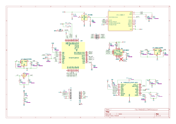
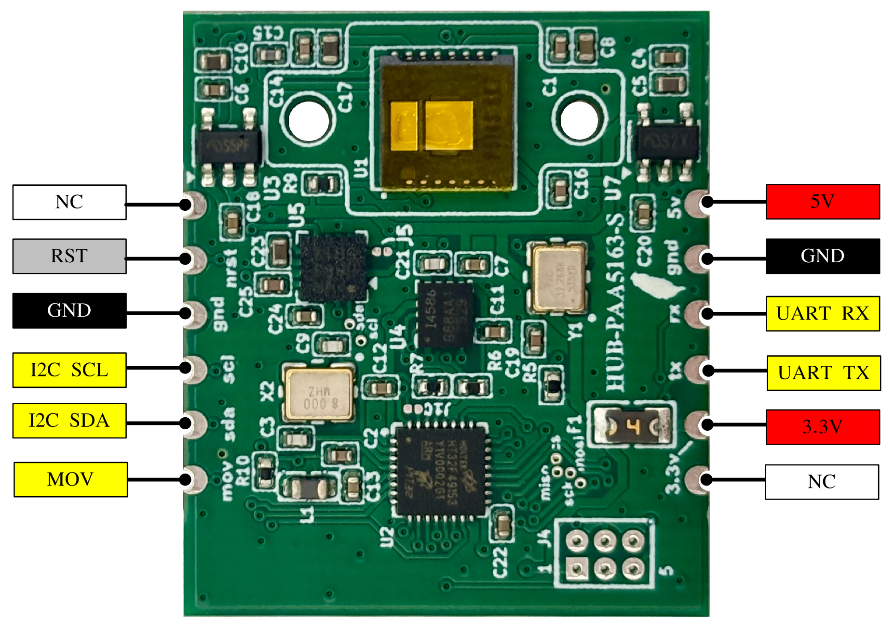
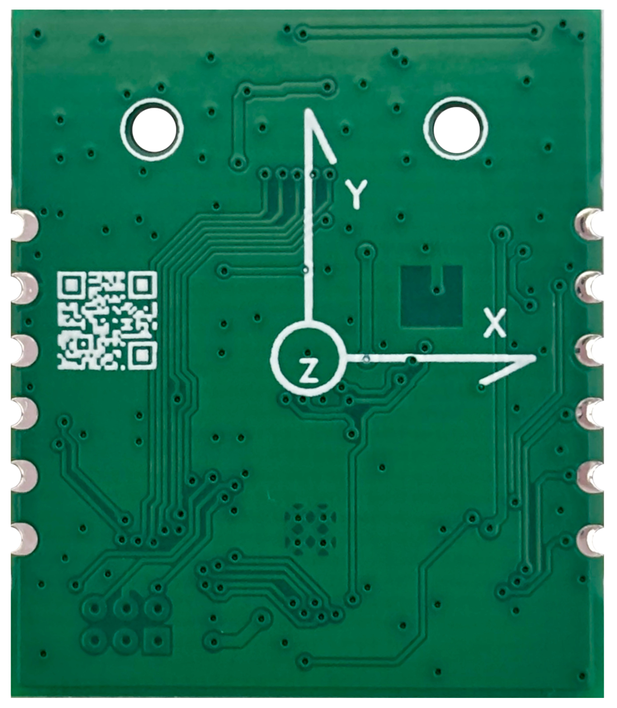

# HUB-PAA5163S 位置移動感測郵票模組使用手冊

| 項目               | 說明                       |
| ------------------ | -------------------------- |
| **版本**     | V1.0                       |
| **日期**     | 2026-06-19                 |
| **韌體版本** | v1.0.7                     |
| **燒錄方式** | SWD/ICE（JTAG/SWD 燒錄器） |
| **作者**     | 顏仲良                     |

---

## 1. 產品概述

HUB-PAA5163S 是一款高精度位置移動感測郵票模組，整合了光流感測器、6軸IMU和3軸電子羅盤，提供完整的2D位移追蹤和姿態測量功能。郵票模組直接貼合於主板，透過 SWD 接腳燒錄韌體，不具備 USB-UART 介面及 DFU 升級功能。

> **注意（STAMP 模式）**：本手冊適用於郵票模組，不支援 USB-UART 通訊介面及 DFU 韌體升級，韌體更新須使用 SWD 接腳搭配 ICE（JTAG/SWD 燒錄器）。

### 主要特色

- **高精度位移追蹤**：結合 PAA5163 光流感測器，適用 5-40mm 工作距離
- **6軸IMU**：ICM42688 陀螺儀 (±2000dps) + 加速度計 (±16g)
- **3軸電子羅盤**：QMC5883P 磁力計，支援傾斜補償
- **雙通訊介面**：
  - **UART**：AT 指令控制（PA2/PA3），適合調試和人機互動
  - **I2C Slave**：寄存器讀寫，適合嵌入式系統整合
- **即時座標計算**：自動角度補償的X/Y座標輸出
- **低延遲更新**：位移更新週期 8ms，姿態更新週期 2ms
- **自動介面切換**：偵測到 I2C 通訊時自動切換模式
- **郵票焊接設計**：直接貼合於主板，透過 SWD 接腳燒錄韌體

### 應用領域

- 機器人定位與導航
- 室內定位系統
- AGV（自動導引車）
- 遊戲控制器
- 手勢識別

---

## 2. 硬體規格

### 微控制器

- **型號**：HT32F49153
- **核心**：32-bit Arm Cortex-M4F
- **時脈**：144 MHz
- **記憶體**：128KB Flash, 48KB SRAM
- **EEPROM模擬**：1KB (Flash模擬)

### 感測器

#### PAA5163 光流感測器

- **解析度**：1000 CPI (可設定)
- **工作距離**：5mm - 40mm
- **最大速度**：>100 inch/s
- **介面**：SPI (最高 2MHz)

#### ICM42688 六軸 IMU

- **陀螺儀量程**：±2000 dps
- **加速度計量程**：±16g
- **更新率**：500 Hz
- **介面**：I2C (400kHz)

#### QMC5883P 電子羅盤

- **量程**：±8 Gauss
- **解析度**：12-bit
- **更新率**：50 Hz
- **介面**：I2C (400kHz)
- **功能**：支援傾斜補償

### 電源規格

- **工作電壓**：3.3V（由主板供電）
- **工作電流**：約 150mA
- **功耗**：約 0.5W

---

## 3. 通訊介面

HUB-PAA5163S 提供二種通訊方式，可根據應用需求選擇：

### 介面對比

| 特性               | UART 介面           | I2C Slave 介面       |
| ------------------ | -------------------- | -------------------- |
| **主要用途** | 調試、測試、人機互動 | 嵌入式系統整合       |
| **控制方式** | AT 指令（文字）      | 寄存器讀寫（二進位） |
| **數據格式** | 文字或JSON           | 二進位結構體         |
| **啟用方式** | 預設啟用             | 自動偵測 I2C 通訊    |
| **通訊速率** | 115200 bps           | 200 kHz              |
| **適用場景** | PC連接、終端操作     | MCU對MCU通訊         |
| **複雜度**   | 簡單（字串處理）     | 中等（寄存器操作）   |
| **即時性**   | 中（輪詢）           | 高（直接記憶體）     |

### 介面切換規則

1. **預設狀態**：模組上電後使用 UART/I2C 介面
2. **自動切換至 I2C**：當檢測到 I2C Slave 通訊時：
   - UART 自動關閉
   - 進入 I2C Slave 模式，運行模式切換為座標模式
   - 所有感測器數據透過 I2C 寄存器訪問
3. **自動切換回 UART**：當檢測到 UART 通訊時：
   - I2C Slave 模式關閉
   - UART 運行 AT 指令模式
4. **恢復 其它介面**：需要重新上電或硬體重置

**注意**：兩種介面不能同時使用，系統會根據檢測到的通訊自動選擇。

---

## 4. 硬體說明

### 電路圖



### 引腳定義



### 硬體座標定義

<div align="center">
  
</div>

#### UART 介面

| 引腳 | 功能    | 說明 |
| ---- | ------- | ---- |
| PA2  | UART TX | 發送 |
| PA3  | UART RX | 接收 |

- **速率**：115200 bps, 8N1
- **用途**：AT 指令通訊，適合外部 MCU 連接
- **啟用方式**：外部傳送訊號至 UART RX，自動

#### I2C2 Slave 介面

| 引腳 | 功能    | 說明   |
| ---- | ------- | ------ |
| PA0  | I2C SDA | 數據線 |
| PA1  | I2C SCL | 時鐘線 |

- **I2C 地址**：0x52 (7-bit) / 0xA4 (8-bit 寫) / 0xA5 (8-bit 讀)
- **速率**：200 kHz（標準模式）
- **用途**：作為 I2C Slave 供外部 MCU 讀寫
- **啟用方式**：當偵測到 I2C 通訊時自動啟用並關閉 UART
- **上拉電阻**：需要 4.7kΩ 上拉至 3.3V
- **寄存器大小**：53 bytes（詳見 [I2C Slave 介面使用](#i2c-slave-介面使用)）

#### 其他控制引腳

| 引腳 | 功能     | 說明                                     |
| ---- | -------- | ---------------------------------------- |
| PB1  | MOV      | 移動指示輸出（可透過 I2C 控制啟用/停用） |
| PA11 | PAA_NRST | PAA5163 硬體重置（可透過 I2C 控制）      |

---

## 5. 快速開始

### 1. 硬體連接

#### 方式 A：UART 通訊連接

1. 將外部 MCU 的 UART TX 連接至模組 PA3 (RX)
2. 將外部 MCU 的 UART RX 連接至模組 PA2 (TX)
3. 連接 GND 共地
4. 主板供電 3.3V 或 5V（模組內部有 LDO 降壓至 3.3V）

> **注意**：STAMP 模式不支援 USB-UART 通訊，請通過硬體 UART 連接外部 MCU。

#### 方式 B：I2C 連接（I2C Slave 模式）

1. 將模組的 PA0 (SDA) 和 PA1 (SCL) 連接至主控 MCU 的 I2C 引腳
2. 在 SDA 和 SCL 上接 4.7kΩ 上拉電阻至 3.3V
3. 連接 GND 共地
4. 主板供電 3.3V 或 5V（模組內部有 LDO 降壓至 3.3V）
5. 當主控 MCU 開始 I2C 通訊時，模組自動切換至 I2C Slave 模式

### 2. 串口設定

- **波特率**：115200
- **數據位**：8
- **停止位**：1
- **校驗位**：無
- **流控制**：無

### 3. 測試連線

#### UART 模式測試

使用串口終端軟體（如 PuTTY、Tera Term、Arduino Serial Monitor）：

```
發送: at
回應: ok
```

#### I2C 模式測試

使用 I2C Master 設備（如 Arduino、STM32、BW16）讀取 ID 寄存器：

```cpp
Wire.begin();
Wire.setClock(200000);  // 200kHz

// 讀取寄存器 0x00 (ID)
Wire.beginTransmission(0x52);
Wire.write(0x00);
Wire.endTransmission();
Wire.requestFrom(0x52, 1);
uint8_t id = Wire.read();  // 應返回 0xA5
```

### 4. 基本操作流程

```bash
# 1. 測試連線
at
# 回應: ok

# 2. 重置並設定零點
at0g+
# 回應: .
#       ok

# 3. 啟動原始模式輸出
atr+
# 回應: ok
# 開始輸出: A=0.0 dX=0.0 dY=0.0 cA=12.3

# 4. 停止輸出
at-
# 回應: stop
```

---

## 6. UART 介面 - AT 指令參考

**適用於**：UART/USB 通訊模式

所有指令均**不區分大小寫**，以 `\r` 或 `\n` 結尾。

### 基本指令

#### `AT`

測試連線是否正常。

**格式**：`AT`

**回應**：`ok`

**範例**：

```
發送: at
回應: ok
```

---

#### `AT?`

顯示韌體版本與所有可用 AT 指令摘要。

**格式**：`AT?`

**回應**：

- 第一行顯示版本字串（例如：`HUB PAA5163S 1.2.3`）
- 後續顯示指令清單與簡要說明

**範例**：

```
發送: at?
回應: HUB PAA5163S 1.2.3
  Available AT commands:
  ...
```

---

### 運行模式指令

#### `ATR+`

啟動**原始模式**輸出。

**格式**：`ATR+`

**回應**：`ok`

**輸出格式**：

```
A=<角度> dX=<原始X位移> dY=<原始Y位移> cA=<羅盤角度>
```

**範例**：

```
發送: atr+
回應: ok
輸出: A=45.2 dX=125.0 dY=-83.5 cA=92.3
```

---

#### `ATX+`

啟動**座標模式**輸出。

**格式**：`ATX+`

**回應**：`ok`

**輸出格式**：

```
A=<角度> X=<X座標> Y=<Y座標> cA=<羅盤角度>
```

**範例**：

```
發送: atx+
回應: ok
輸出: A=45.2 X=12.5 Y=-8.3 cA=92.3
```

---

#### `ATC+`

啟動**完整模式**輸出（含 Roll/Pitch）。

**格式**：`ATC+`

**回應**：`ok`

**輸出格式**：

```
A=<角度> X=<X座標> Y=<Y座標> R=<Roll> P=<Pitch> cA=<羅盤角度> tA=<原始羅盤>
```

**範例**：

```
發送: atc+
回應: ok
輸出: A=45.2 X=12.5 Y=-8.3 R=2.1 P=-1.5 cA=92.3 tA=89.8
```

---

#### `AT-`

停止數據輸出。

**格式**：`AT-`

**回應**：`stop`

**範例**：

```
發送: at-
回應: stop
```

---

### 校正與設定指令

#### `AT0G+`

重置所有感測器數據並設定零點。

**格式**：`AT0G+`

**功能**：

- 重置 IMU 陀螺儀和加速度計
- 重置 PAA5163 光流感測器
- 重置 X/Y 座標為 0
- 使用向量平均法設定羅盤零點（讀取10次，每20ms一次）

**回應**：

```
.
ok
```

**範例**：

```
發送: at0g+
回應: .
      ok
```

**注意**：此過程約需 200ms，期間請保持模組靜止。

---

#### `AT0C+8`

校正電子羅盤（標準模式）。

**格式**：`AT0C+8`

**功能**：啟動 20 秒羅盤校正程序，使用橢圓擬合演算法。

**操作步驟**：

1. 發送 `AT0C+8` 指令
2. 在 20 秒內緩慢旋轉模組，至少完整旋轉一圈
3. 等待校正完成

**回應**：

```
Start rolling 20 sec, get new cmpsCalData
ok minX=<值> maxX=<值> minY=<值> maxY=<值> minZ=<值> maxZ=<值>
```

**範例**：

```
發送: at0c+8
回應: Start rolling 20 sec, get new cmpsCalData
      ok minX=-1234 maxX=1156 minY=-1289 maxY=1098 minZ=-1456 maxZ=1234
```

**注意**：

- 校正數據會自動儲存至 EEPROM
- 建議在干擾較少的環境進行校正
- 旋轉時應包含三個軸向

---

#### `AT0M+8`

校正電子羅盤（最大最小值模式）。

**格式**：`AT0M+8`

**功能**：啟動 20 秒羅盤校正程序，使用最大最小值演算法。

**操作步驟**：同 `AT0C+8`

**回應**：

```
Start rolling 20 sec, get updated cmpsCalData
ok minX=<值> maxX=<值> minY=<值> maxY=<值> minZ=<值> maxZ=<值>
```

---

#### `ATI+C`

查詢報告間隔及當前羅盤校正數據。

**格式**：`ATI+C`

**回應**：

```
Report interval: <間隔> ms
Compass calibration data:
<minX>,<maxX>,<minY>,<maxY>,<minZ>,<maxZ>
```

**範例**：

```
發送: ati+c
回應: Report interval: 200 ms
      Compass calibration data:
      -1234,1156,-1289,1098,-1456,1234
```

---

#### `ATI&<參數>`

手動設定羅盤校正數據。

**格式**：`ATI&<minX>,<maxX>,<minY>,<maxY>,<minZ>,<maxZ>`

**參數**：6 個整數值，以逗號分隔

**回應**：

- 成功：`Compass calibration data updated.`
- 失敗：`err`

**範例**：

```
發送: ati&-1234,1156,-1289,1098,-1456,1234
回應: Compass calibration data updated.
```

---

### 參數設定指令

#### `ATRPT+<時間>`

設定數據報告間隔時間。

**格式**：`ATRPT+<毫秒>`

**參數範圍**：50 ~ 1000 (ms)

**預設值**：200 ms

**回應**：

- 成功：`Set report time <時間> ms.`
- 失敗：`err`

**範例**：

```
發送: atrpt+100
回應: Set report time 100 ms.
```

---

### 硬體控制指令

#### `ATM+`

啟用 movPin（PB1）移動指示輸出。

**格式**：`ATM+`

**回應**：

- 啟用成功：`Movement index output enabled`
- 已啟用：`Movement index output already enabled`

---

#### `ATM-`

停用 movPin（PB1）移動指示輸出。

**格式**：`ATM-`

**回應**：

- 停用成功：`Movement index output disabled`
- 已停用：`Movement index output already disabled`

---

#### `ATNRST+OMT`

對 PAA5163 執行硬體 NRST 重置，並重新初始化感測器。

**格式**：`ATNRST+OMT`

**回應**：

```
.
ok
```

---

### 輸出控制指令

#### `ATJ+`

啟用 JSON 格式輸出。

**格式**：`ATJ+`

**回應**：`JSON output enabled`

**輸出範例**（原始模式）：

```json
{"A":45.2,"dX":125.0,"dY":-83.5,"cA":92.3}
```

**輸出範例**（座標模式）：

```json
{"A":45.2,"X":12.5,"Y":-8.3,"cA":92.3}
```

**輸出範例**（完整模式）：

```json
{"A":45.2,"X":12.5,"Y":-8.3,"R":2.1,"P":-1.5,"cA":92.3,"tA":89.8}
```

---

#### `ATJ-`

停用 JSON 格式輸出（恢復文字格式）。

**格式**：`ATJ-`

**回應**：`JSON output disabled`

---

### 指令摘要表

| 指令           | 功能                   | 參數                          |
| -------------- | ---------------------- | ----------------------------- |
| `AT`         | 測試連線               | 無                            |
| `AT?`        | 顯示版本與指令清單     | 無                            |
| `ATR+`       | 啟動原始模式           | 無                            |
| `ATX+`       | 啟動座標模式           | 無                            |
| `ATC+`       | 啟動完整模式           | 無                            |
| `AT-`        | 停止輸出               | 無                            |
| `AT0G+`      | 重置並設定零點         | 無                            |
| `AT0C+8`     | 校正羅盤（標準）       | 無                            |
| `AT0M+8`     | 校正羅盤（最大最小值） | 無                            |
| `ATI+C`      | 查詢報告間隔及校正數據 | 無                            |
| `ATI&`       | 設定校正數據           | minX,maxX,minY,maxY,minZ,maxZ |
| `ATRPT+`     | 設定報告間隔           | 50-1000                       |
| `ATM+`       | 啟用 movPin 輸出       | 無                            |
| `ATM-`       | 停用 movPin 輸出       | 無                            |
| `ATJ+`       | 啟用JSON輸出           | 無                            |
| `ATJ-`       | 停用JSON輸出           | 無                            |
| `ATNRST+OMT` | 硬體重置 PAA5163       | 無                            |

---

## 7. I2C Slave 介面使用

**適用於**：I2C Slave 通訊模式

### 概述

當模組偵測到 I2C 通訊時，會自動切換至 I2C Slave 模式：

- UART 串口自動關閉（節省資源）
- 所有感測器數據透過 I2C 寄存器訪問
- 控制命令透過寫入控制位元寄存器實現
- 運行模式自動切換為座標模式（含 X/Y/angleZ/compass）

### I2C 寄存器映射

**I2C Slave 地址**：0x52 (7-bit)
**寄存器總大小**：53 bytes
**位址寬度**：8-bit

| 偏移 | 大小 | 類型      | 名稱              | 說明               | 範圍      |
| ---- | ---- | --------- | ----------------- | ------------------ | --------- |
| 0x00 | 1    | uint8_t   | id                | 固定 ID 值         | 0xA5      |
| 0x01 | 1    | uint8_t   | controlBits       | 控制位元（見下表） | -         |
| 0x02 | 2    | uint16_t  | reportIntervalMs  | 報告間隔時間 (ms)  | 50-1000   |
| 0x04 | 1    | uint8_t   | *                 | *                  |           |
| 0x05 | 4    | float32_t | X                 | X 座標 (cm)        | -         |
| 0x09 | 4    | float32_t | Y                 | Y 座標 (cm)        | -         |
| 0x0D | 4    | float32_t | dX                | X 偏移 (cpi)       | -         |
| 0x11 | 4    | float32_t | dY                | Y 偏移 (cpi)       | -         |
| 0x15 | 4    | float32_t | angleZ            | Z 軸角度 (度)      | -180~+180 |
| 0x19 | 4    | float32_t | compassHeading    | 羅盤航向角 (度)    | 0~360     |
| 0x1D | 4    | float32_t | rawCompassHeading | 原始羅盤角度 (度)  | -         |
| 0x21 | 4    | float32_t | roll              | Roll 角度 (度)     | -         |
| 0x25 | 4    | float32_t | pitch             | Pitch 角度 (度)    | -         |
| 0x29 | 2    | int16_t   | compassMinX       | 羅盤校正最小值 X   | -         |
| 0x2B | 2    | int16_t   | compassMaxX       | 羅盤校正最大值 X   | -         |
| 0x2D | 2    | int16_t   | compassMinY       | 羅盤校正最小值 Y   | -         |
| 0x2F | 2    | int16_t   | compassMaxY       | 羅盤校正最大值 Y   | -         |
| 0x31 | 2    | int16_t   | compassMinZ       | 羅盤校正最小值 Z   | -         |
| 0x33 | 2    | int16_t   | compassMaxZ       | 羅盤校正最大值 Z   | -         |

**注意事項**：

- **float32_t**：IEEE 754 單精度浮點格式，Little-Endian
- **int16_t/uint16_t**：有符號/無符號16位整數，Little-Endian
- 羅盤校正值為有符號整數（int16_t），範圍約 -32768 ~ +32767

### controlBits 位元定義

| Bit | 名稱               | R/W | 說明                                                       |
| --- | ------------------ | --- | ---------------------------------------------------------- |
| 0   | MOVE_PIN_EN        | R/W | 移動指示輸出啟用`<br>`寫1=啟用 PB1輸出，寫0=停用         |
| 1   | SET_ZERO_PROGRESS  | R/W | 設定零點`<br>`寫1=開始設定，讀0=完成                     |
| 2   | CMPS_CAL_START     | R/W | 開始羅盤校正（新方法）`<br>`寫1=開始20秒校正，讀0=完成   |
| 3   | CMPS_CAL_OLD_START | R/W | 羅盤校正（舊值基礎）`<br>`寫1=開始20秒校正，讀0=完成     |
| 4   | SET_CMPS_CAL_DATA  | R/W | 設定羅盤校正數據`<br>`寫1=套用校正值，讀0=完成           |
| 5   | PAA_NRST_PIN       | R/W | PAA5163 NRST 引腳狀態`<br>`1=high, 0=low（用於硬體重置） |
| 6   | UPDATE_SENSORS     | R/W | 更新感測器數據`<br>`寫1=觸發更新，讀0=完成               |
| 7   | -                  | -   | 保留                                                       |

### I2C 操作流程

以下範例基於 Arduino Wire 庫，可適用於 Arduino、ESP32、STM32 等平台。

#### 1. 讀取感測器數據（標準流程）

```cpp
#define I2C_ADDR 0x52
#define REG_CONTROL_BITS 0x01
#define CTRL_BIT_UPDATE_SENSORS (1 << 6)

bool updateSensors() {
    // 步驟1: 觸發感測器數據更新
    uint8_t ctrl = i2c_read_byte(I2C_ADDR, REG_CONTROL_BITS);
    ctrl |= CTRL_BIT_UPDATE_SENSORS;
    i2c_write_byte(I2C_ADDR, REG_CONTROL_BITS, ctrl);
  
    // 步驟2: 等待更新完成（輪詢，最多800ms超時）
    unsigned long startTime = millis();
    while (millis() - startTime < 800) {
        delay(10);
        ctrl = i2c_read_byte(I2C_ADDR, REG_CONTROL_BITS);
        if (!(ctrl & CTRL_BIT_UPDATE_SENSORS)) {
            return true;  // 更新完成
        }
    }
    return false;  // 超時
}

void readSensorData() {
    if (updateSensors()) {
        // 步驟3: 讀取感測器數據
        float x = i2c_read_float(I2C_ADDR, 0x05);
        float y = i2c_read_float(I2C_ADDR, 0x09);
        float angleZ = i2c_read_float(I2C_ADDR, 0x15);
        float compass = i2c_read_float(I2C_ADDR, 0x19);
  
        Serial.print("X: "); Serial.print(x, 2);
        Serial.print(" Y: "); Serial.print(y, 2);
        Serial.print(" Angle: "); Serial.print(angleZ, 1);
        Serial.print(" Compass: "); Serial.println(compass, 1);
    } else {
        Serial.println("Sensor update timeout!");
    }
}
```

#### 2. 設定零點

```cpp
#define CTRL_BIT_SET_ZERO_PROGRESS (1 << 1)

void setZeroPoint() {
    Serial.println("Setting zero point...");
  
    // 設定 bit 1
    uint8_t ctrl = i2c_read_byte(I2C_ADDR, REG_CONTROL_BITS);
    ctrl |= CTRL_BIT_SET_ZERO_PROGRESS;
    i2c_write_byte(I2C_ADDR, REG_CONTROL_BITS, ctrl);
  
    // 等待完成（最多 3 秒）
    unsigned long startTime = millis();
    while (millis() - startTime < 3000) {
        delay(100);
        ctrl = i2c_read_byte(I2C_ADDR, REG_CONTROL_BITS);
        if (!(ctrl & CTRL_BIT_SET_ZERO_PROGRESS)) {
            Serial.println("Zero point set completed!");
            return;
        }
    }
    Serial.println("Zero point setting timeout!");
}
```

#### 3. 校正電子羅盤

```cpp
#define CTRL_BIT_CMPS_CAL_START (1 << 2)
#define REG_COMPASS_MIN_X 0x29

void calibrateCompass() {
    Serial.println("Starting compass calibration...");
    Serial.println("Please rotate device for 20 seconds!");
  
    // 設定 bit 2 開始校正
    uint8_t ctrl = i2c_read_byte(I2C_ADDR, REG_CONTROL_BITS);
    ctrl |= CTRL_BIT_CMPS_CAL_START;
    i2c_write_byte(I2C_ADDR, REG_CONTROL_BITS, ctrl);
  
    // 等待校正完成（最多 25 秒）
    unsigned long startTime = millis();
    while (millis() - startTime < 25000) {
        delay(100);
        ctrl = i2c_read_byte(I2C_ADDR, REG_CONTROL_BITS);
        if (!(ctrl & CTRL_BIT_CMPS_CAL_START)) {
            Serial.println("Compass calibration completed!");
  
            // 讀取校正結果
            int16_t minX = (int16_t)i2c_read_word(I2C_ADDR, REG_COMPASS_MIN_X);
            int16_t maxX = (int16_t)i2c_read_word(I2C_ADDR, REG_COMPASS_MIN_X + 2);
            int16_t minY = (int16_t)i2c_read_word(I2C_ADDR, REG_COMPASS_MIN_X + 4);
            int16_t maxY = (int16_t)i2c_read_word(I2C_ADDR, REG_COMPASS_MIN_X + 6);
            int16_t minZ = (int16_t)i2c_read_word(I2C_ADDR, REG_COMPASS_MIN_X + 8);
            int16_t maxZ = (int16_t)i2c_read_word(I2C_ADDR, REG_COMPASS_MIN_X + 10);
  
            Serial.println("Calibration Data:");
            Serial.print("  X: "); Serial.print(minX); 
            Serial.print(" ~ "); Serial.println(maxX);
            Serial.print("  Y: "); Serial.print(minY); 
            Serial.print(" ~ "); Serial.println(maxY);
            Serial.print("  Z: "); Serial.print(minZ); 
            Serial.print(" ~ "); Serial.println(maxZ);
            return;
        }
        if ((millis() - startTime) % 1000 == 0) {
            Serial.print(".");  // 每秒顯示進度
        }
    }
    Serial.println("\nCompass calibration timeout!");
}
```

#### 4. 手動設定羅盤校正數據

```cpp
#define CTRL_BIT_SET_CMPS_CAL_DATA (1 << 4)

void setCompassCalData(int16_t minX, int16_t maxX, 
                       int16_t minY, int16_t maxY,
                       int16_t minZ, int16_t maxZ) {
    // 寫入校正數據到寄存器
    i2c_write_word(I2C_ADDR, 0x29, minX);
    i2c_write_word(I2C_ADDR, 0x2B, maxX);
    i2c_write_word(I2C_ADDR, 0x2D, minY);
    i2c_write_word(I2C_ADDR, 0x2F, maxY);
    i2c_write_word(I2C_ADDR, 0x31, minZ);
    i2c_write_word(I2C_ADDR, 0x33, maxZ);
  
    Serial.println("Setting compass calibration data...");
  
    // 設定 bit 4 以套用數據
    uint8_t ctrl = i2c_read_byte(I2C_ADDR, REG_CONTROL_BITS);
    ctrl |= CTRL_BIT_SET_CMPS_CAL_DATA;
    i2c_write_byte(I2C_ADDR, REG_CONTROL_BITS, ctrl);
  
    // 等待完成（最多 3 秒）
    unsigned long startTime = millis();
    while (millis() - startTime < 3000) {
        delay(10);
        ctrl = i2c_read_byte(I2C_ADDR, REG_CONTROL_BITS);
        if (!(ctrl & CTRL_BIT_SET_CMPS_CAL_DATA)) {
            Serial.println("Calibration data applied!");
            return;
        }
    }
    Serial.println("Calibration data write timeout!");
}

// 使用範例
void setup() {
    // 設定校正數據：minX, maxX, minY, maxY, minZ, maxZ
    setCompassCalData(-1234, 1156, -1289, 1098, -1456, 1234);
}
```

#### 5. 控制移動指示輸出 (MOV Pin)

```cpp
#define CTRL_BIT_MOVE_PIN_EN (1 << 0)

void enableMovePin(bool enable) {
    uint8_t ctrl = i2c_read_byte(I2C_ADDR, REG_CONTROL_BITS);
  
    if (enable) {
        ctrl |= CTRL_BIT_MOVE_PIN_EN;
        Serial.println("Motion indicator enabled");
    } else {
        ctrl &= ~CTRL_BIT_MOVE_PIN_EN;
        Serial.println("Motion indicator disabled");
    }
  
    i2c_write_byte(I2C_ADDR, REG_CONTROL_BITS, ctrl);
}

// PB1 引腳會在偵測到移動時輸出高電平
```

#### 6. 設定報告間隔

```cpp
#define REG_REPORT_INTERVAL_MS 0x02

void setReportInterval(uint16_t intervalMs) {
    if (intervalMs < 50 || intervalMs > 1000) {
        Serial.println("Interval range: 50-1000 ms");
        return;
    }
  
    i2c_write_word(I2C_ADDR, REG_REPORT_INTERVAL_MS, intervalMs);
  
    Serial.print("Report interval set to: ");
    Serial.print(intervalMs);
    Serial.println(" ms");
}
```

### I2C 輔助函式實作

以下是完整的 I2C 讀寫函式實作（Arduino Wire 庫）：

```cpp
// 讀取單個位元組
uint8_t i2c_read_byte(uint8_t addr, uint8_t reg) {
    Wire.beginTransmission(addr);
    Wire.write(reg);
    if (Wire.endTransmission() != 0) {
        return 0;
    }
  
    Wire.requestFrom(addr, 1);
    unsigned long startTime = micros();
    while (Wire.available() == 0) {
        if (micros() - startTime > 100) return 0;  // 100us 超時
        delayMicroseconds(10);
    }
  
    return Wire.available() ? Wire.read() : 0;
}

// 寫入單個位元組
void i2c_write_byte(uint8_t addr, uint8_t reg, uint8_t value) {
    Wire.beginTransmission(addr);
    Wire.write(reg);
    Wire.write(value);
    Wire.endTransmission();
    delay(10);  // 等待寫入完成
}

// 讀取 16-bit 字（Little-Endian）
uint16_t i2c_read_word(uint8_t addr, uint8_t reg) {
    Wire.beginTransmission(addr);
    Wire.write(reg);
    if (Wire.endTransmission() != 0) {
        return 0;
    }
  
    Wire.requestFrom(addr, 2);
    unsigned long startTime = micros();
    while (Wire.available() < 2) {
        if (micros() - startTime > 200) return 0;  // 200us 超時
        delayMicroseconds(10);
    }
  
    if (Wire.available() >= 2) {
        uint8_t low = Wire.read();
        uint8_t high = Wire.read();
        return (high << 8) | low;
    }
    return 0;
}

// 寫入 16-bit 字（Little-Endian）
void i2c_write_word(uint8_t addr, uint8_t reg, uint16_t value) {
    Wire.beginTransmission(addr);
    Wire.write(reg);
    Wire.write(value & 0xFF);         // 低位元組
    Wire.write((value >> 8) & 0xFF);  // 高位元組
    Wire.endTransmission();
    delay(10);
}

// 讀取浮點數（IEEE 754，Little-Endian）
float i2c_read_float(uint8_t addr, uint8_t reg) {
    Wire.beginTransmission(addr);
    Wire.write(reg);
    if (Wire.endTransmission() != 0) {
        return 0.0f;
    }
  
    Wire.requestFrom(addr, 4);
    unsigned long startTime = micros();
    while (Wire.available() < 4) {
        if (micros() - startTime > 300) return 0.0f;  // 300us 超時
        delayMicroseconds(10);
    }
  
    if (Wire.available() >= 4) {
        union {
            uint8_t bytes[4];
            float value;
        } data;
        data.bytes[0] = Wire.read();
        data.bytes[1] = Wire.read();
        data.bytes[2] = Wire.read();
        data.bytes[3] = Wire.read();
        return data.value;
    }
    return 0.0f;
}

// 寫入浮點數（IEEE 754，Little-Endian）
void i2c_write_float(uint8_t addr, uint8_t reg, float value) {
    union {
        float f;
        uint8_t bytes[4];
    } data;
    data.f = value;
  
    Wire.beginTransmission(addr);
    Wire.write(reg);
    Wire.write(data.bytes, 4);
    Wire.endTransmission();
    delay(10);
}
```

### I2C 完整應用範例

參考專案中的 `test_hub5168_i2c/test_hub5168_i2c.ino` 與 `test_hub5168_i2c/README.md`，這是目前實際使用的 Hub5168+ (BW16) I2C Master 測試程序。

**建議接線**：

- Hub5168+ `PA26 (SDA)` → HUB-PAA5163S `PA0 (I2C2 SDA)`
- Hub5168+ `PA25 (SCL)` → HUB-PAA5163S `PA1 (I2C2 SCL)`
- `GND` ↔ `GND`
- `SDA`、`SCL` 都需以 `4.7kΩ` 上拉到 `3.3V`

**程式內建命令**（依 `test_hub5168_i2c.ino` 實作）：

| 命令                                 | 功能                                        |
| ------------------------------------ | ------------------------------------------- |
| `ssr`                              | 觸發`UPDATE_SENSORS` 後讀取全部感測器資料 |
| `inf`                              | 讀取裝置資訊                                |
| `id`                               | 讀取裝置 ID (`0xA5`)                      |
| `ctrl`                             | 讀取 controlBits                            |
| `cd`                               | 讀取羅盤校正資料                            |
| `ca minX maxX minY maxY minZ maxZ` | 手動寫入羅盤校正資料                        |
| `z`                                | 設定零點                                    |
| `c`                                | 啟動羅盤校正（新方法）                      |
| `o`                                | 啟動羅盤校正（沿用舊值）                    |
| `m+` / `m-`                      | 啟用 / 停用 movPin 輸出                     |
| `t<ms>`                            | 設定報告間隔，例如`t200`                  |
| `a+` / `a-`                      | 啟用 / 停用自動讀取（預設 500ms）           |
| `j+` / `j-`                      | 啟用 / 停用 JSON 格式輸出                   |
| `?`                                | 顯示命令選單                                |

**測試程式輸出格式**：

- 文字模式：`Position / Offset / Angle / Compass / Attitude`
- JSON 模式：`{"X":...,"Y":...,"dX":...,"dY":...,"angleZ":...,"compass":...,"rawCompass":...,"roll":...,"pitch":...}`

若要直接在現場驗證 I2C 通訊，建議優先使用這個測試程式，而不是自行從零撰寫主控端程式。

---

## 8. 數據輸出格式

### 文字格式

#### 模式 1：原始模式 (ATR+)

```
A=<角度> dX=<原始X位移> dY=<原始Y位移> cA=<羅盤角度>
```

**參數說明**：

- `A`: IMU Z軸角度，範圍 -180° ~ +180°
- `dX`: 原始X軸累積位移（CPI單位）
- `dY`: 原始Y軸累積位移（CPI單位）
- `cA`: 電子羅盤航向角，範圍 0° ~ 360°

#### 模式 2：座標模式 (ATX+)

```
A=<角度> X=<X座標> Y=<Y座標> cA=<羅盤角度>
```

**參數說明**：

- `A`: IMU Z軸角度，範圍 -180° ~ +180°
- `X`: 經角度補償的X座標 (cm)
- `Y`: 經角度補償的Y座標 (cm)
- `cA`: 電子羅盤航向角，範圍 0° ~ 360°

#### 模式 3：完整模式 (ATC+)

```
A=<角度> X=<X座標> Y=<Y座標> R=<Roll> P=<Pitch> cA=<羅盤角度> tA=<原始羅盤>
```

**參數說明**：

- `A`: IMU Z軸角度，範圍 -180° ~ +180°
- `X`: 經角度補償的X座標 (cm)
- `Y`: 經角度補償的Y座標 (cm)
- `R`: Roll 角度（翻滾角）
- `P`: Pitch 角度（俯仰角）
- `cA`: 經傾斜補償的羅盤航向角，範圍 0° ~ 360°
- `tA`: 原始羅盤讀數（未補償）

### JSON 格式 (啟用 ATJ+ 後)

#### 原始模式

```json
{"A":45.2,"dX":125.0,"dY":-83.5,"cA":92.3}
```

#### 座標模式

```json
{"A":45.2,"X":12.5,"Y":-8.3,"cA":92.3}
```

#### 完整模式

```json
{"A":45.2,"X":12.5,"Y":-8.3,"R":2.1,"P":-1.5,"cA":92.3,"tA":89.8}
```

### 更新頻率

- **位移數據**：每 8ms 更新一次（125 Hz）
- **IMU數據**：每 2ms 更新一次（500 Hz）
- **羅盤數據**：每 20ms 更新一次（50 Hz）
- **數據輸出**：根據 `ATRPT+` 設定（預設 200ms）

---

## 9. 應用範例

> **注意**：STAMP 模式使用硬體 UART（PA2/PA3），不支援 USB-UART 介面。範例中的 `'COM3'` 或 `/dev/ttyUSB0` 需替換為連接主板 UART 的實際串口號。

### 範例 1：基本位移追蹤

```python
import serial
import json
import time


def send_command(ser, command, wait=0.1, max_lines=4):
    ser.write((command + "\r\n").encode())
    time.sleep(wait)
    lines = []
    for _ in range(max_lines):
        line = ser.readline().decode(errors="ignore").strip()
        if line:
            lines.append(line)
    return lines

# 開啟串口（UART，非 USB CDC）
ser = serial.Serial('COM3', 115200, timeout=0.5)

# 測試連線
print(send_command(ser, 'at'))

# 重置並設定零點（會回應 '.' 與 'ok'）
print(send_command(ser, 'at0g+', wait=0.4))

# 啟用 JSON 輸出
print(send_command(ser, 'atj+'))

# 設定輸出間隔 100ms
print(send_command(ser, 'atrpt+100'))

# 啟用座標模式
print(send_command(ser, 'atx+'))

# 讀取位置數據
while True:
    line = ser.readline().decode(errors='ignore').strip()
    if line.startswith('{'):
        data = json.loads(line)
        print(
            f"X={data['X']:.1f} cm, Y={data['Y']:.1f} cm, "
            f"A={data['A']:.1f}°, cA={data['cA']:.1f}°"
        )
```

### 範例 2：羅盤校正程序

```python
import serial
import time

ser = serial.Serial('COM3', 115200, timeout=1)

# 啟動校正
ser.write(b'at0c+8\r\n')
print("開始校正，請緩慢旋轉模組...")

# 立即回應：開始提示
print(ser.readline().decode(errors='ignore').strip())

# 韌體會在校正完成前阻塞約 20 秒，完成後才回傳結果
ser.timeout = 25
print(ser.readline().decode(errors='ignore').strip())
ser.timeout = 1

# 查詢校正結果
ser.write(b'ati+c\r\n')
time.sleep(0.1)
for _ in range(4):
  line = ser.readline().decode(errors='ignore').strip()
  if line:
    print(line)
```

### 範例 3：機器人導航應用

```python
import json
import math
import serial
import time


def send_command(ser, command, wait=0.1, max_lines=4):
  ser.write((command + "\r\n").encode())
  time.sleep(wait)
  lines = []
  for _ in range(max_lines):
    line = ser.readline().decode(errors="ignore").strip()
    if line:
      lines.append(line)
  return lines


class PositionTracker:
  def __init__(self, port="COM3"):
    self.ser = serial.Serial(port, 115200, timeout=0.5)
    self.init_sensor()

  def init_sensor(self):
    print(send_command(self.ser, "at"))
    print(send_command(self.ser, "at0g+", wait=0.4))
    print(send_command(self.ser, "atj+"))
    print(send_command(self.ser, "atrpt+100"))
    print(send_command(self.ser, "atc+"))

  def get_position(self):
    line = self.ser.readline().decode(errors="ignore").strip()
    if line.startswith("{"):
      return json.loads(line)
    return None

  def navigate_to(self, target_x, target_y):
    while True:
      pos = self.get_position()
      if pos is None:
        continue

      dx = target_x - pos["X"]
      dy = target_y - pos["Y"]
      distance = math.sqrt(dx ** 2 + dy ** 2)
      target_angle = math.degrees(math.atan2(dy, dx))

      angle_diff = target_angle - pos["A"]
      if angle_diff > 180:
        angle_diff -= 360
      elif angle_diff < -180:
        angle_diff += 360

      print(
        f"Distance: {distance:.1f} cm, Angle diff: {angle_diff:.1f}°, "
        f"Compass: {pos['cA']:.1f}°"
      )

      if distance < 5:
        print("目標已到達！")
        break

      # control_motors(distance, angle_diff)


tracker = PositionTracker("COM3")
tracker.navigate_to(100, 50)
```

**說明**：此範例使用 UART/USB 的 `ATC+` 輸出，若要使用 Hub5168+ 做 I2C 主控測試，請改用 `test_hub5168_i2c/test_hub5168_i2c.ino` 的 `ssr`、`a+`、`cd`、`ca` 等命令流程。

### 範例 4：Arduino UART + OLED 顯示

本範例展示如何使用 Arduino 透過 UART 連接 HUB-PAA5163S 模組，並將位置資訊顯示在 OLED 螢幕上。

**硬體連接**：

- HUB-PAA5163S PA2 (TX) → Arduino RX (Pin 10)
- HUB-PAA5163S PA3 (RX) → Arduino TX (Pin 11)
- HUB-PAA5163S GND → Arduino GND
- OLED SDA → Arduino A4 (SDA)
- OLED SCL → Arduino A5 (SCL)
- OLED VCC → Arduino 3.3V 或 5V
- OLED GND → Arduino GND

**所需函式庫**：

- `SoftwareSerial`：Arduino 內建
- `Adafruit_SSD1306`：OLED 顯示
- `Adafruit_GFX`：圖形庫

```cpp
#include <SoftwareSerial.h>
#include <Wire.h>
#include <Adafruit_GFX.h>
#include <Adafruit_SSD1306.h>

// OLED 顯示器設定
#define SCREEN_WIDTH 128
#define SCREEN_HEIGHT 64
#define OLED_RESET    -1
Adafruit_SSD1306 display(SCREEN_WIDTH, SCREEN_HEIGHT, &Wire, OLED_RESET);

// HUB-PAA5163S 軟體串口設定
#define RX_PIN 10
#define TX_PIN 11
SoftwareSerial hubSerial(RX_PIN, TX_PIN);

// 數據結構
struct SensorData {
  float x;
  float y;
  float angle;
  float compassAngle;
  float roll;
  float pitch;
  bool valid;
};

SensorData currentData = {0, 0, 0, 0, 0, 0, false};
String inputBuffer = "";

void setup() {
  Serial.begin(115200);  // 除錯用
  hubSerial.begin(115200);  // HUB-PAA5163S 通訊
  
  // 初始化 OLED
  if(!display.begin(SSD1306_SWITCHCAPVCC, 0x3C)) {
    Serial.println(F("OLED init failed!"));
    while(1);
  }
  
  display.clearDisplay();
  display.setTextSize(1);
  display.setTextColor(SSD1306_WHITE);
  display.setCursor(0, 0);
  display.println(F("HUB-PAA5163S"));
  display.println(F("Initializing..."));
  display.display();
  
  delay(2000);
  
  // 初始化 HUB-PAA5163S
  initHub5163();
  
  display.clearDisplay();
  display.setCursor(0, 0);
  display.println(F("Ready!"));
  display.display();
  delay(1000);
}

void loop() {
  // 讀取 HUB-PAA5163S 數據
  while (hubSerial.available()) {
    char c = hubSerial.read();
  
    if (c == '\n' || c == '\r') {
      if (inputBuffer.length() > 0) {
        parseData(inputBuffer);
        inputBuffer = "";
      }
    } else {
      inputBuffer += c;
    }
  }
  
  // 更新顯示
  if (currentData.valid) {
    updateDisplay();
  }
  
  delay(50);
}

void initHub5163() {
  // 確保 PA3 (RX) 為高電平以啟用 USART1
  // 注意：需要在硬體上將 PA3 透過電阻上拉至 3.3V
  
  delay(500);
  
  // 測試連線
  hubSerial.println("at");
  delay(100);
  
  // 重置並設定零點
  hubSerial.println("at0g+");
  delay(1000);
  
  // 啟用 JSON 輸出
  hubSerial.println("atj+");
  delay(100);
  
  // 啟用完整模式（含 Roll/Pitch）
  hubSerial.println("atc+");
  delay(100);
  
  // 設定更新間隔為 100ms
  hubSerial.println("atrpt+100");
  delay(100);
  
  Serial.println("HUB-PAA5163S initialized");
}

void parseData(String data) {
  // 解析 JSON 格式: {"A":45.2,"X":12.5,"Y":-8.3,"R":2.1,"P":-1.5,"cA":92.3,"tA":89.8}
  if (data.startsWith("{") && data.endsWith("}")) {
    // 簡易 JSON 解析（生產環境建議使用 ArduinoJson 函式庫）
    currentData.angle = extractValue(data, "\"A\":");
    currentData.x = extractValue(data, "\"X\":");
    currentData.y = extractValue(data, "\"Y\":");
    currentData.roll = extractValue(data, "\"R\":");
    currentData.pitch = extractValue(data, "\"P\":");
    currentData.compassAngle = extractValue(data, "\"cA\":");
    currentData.valid = true;
  
    // 除錯輸出
    Serial.print("X:");
    Serial.print(currentData.x);
    Serial.print(" Y:");
    Serial.print(currentData.y);
    Serial.print(" A:");
    Serial.println(currentData.angle);
  } else {
    // 解析文字格式: A=45.2 X=12.5 Y=-8.3 R=2.1 P=-1.5 cA=92.3
    currentData.angle = extractTextValue(data, "A=");
    currentData.x = extractTextValue(data, "X=");
    currentData.y = extractTextValue(data, "Y=");
    currentData.roll = extractTextValue(data, "R=");
    currentData.pitch = extractTextValue(data, "P=");
    currentData.compassAngle = extractTextValue(data, "cA=");
    currentData.valid = true;
  }
}

float extractValue(String json, String key) {
  int pos = json.indexOf(key);
  if (pos == -1) return 0.0;
  
  pos += key.length();
  int endPos = json.indexOf(',', pos);
  if (endPos == -1) {
    endPos = json.indexOf('}', pos);
  }
  
  String value = json.substring(pos, endPos);
  return value.toFloat();
}

float extractTextValue(String text, String key) {
  int pos = text.indexOf(key);
  if (pos == -1) return 0.0;
  
  pos += key.length();
  int endPos = text.indexOf(' ', pos);
  if (endPos == -1) {
    endPos = text.length();
  }
  
  String value = text.substring(pos, endPos);
  return value.toFloat();
}

void updateDisplay() {
  display.clearDisplay();
  display.setTextSize(1);
  display.setTextColor(SSD1306_WHITE);
  
  // 標題
  display.setCursor(0, 0);
  display.println(F("=== HUB-PAA5163S ==="));
  
  // 座標資訊
  display.setCursor(0, 12);
  display.print(F("X: "));
  display.print(currentData.x, 1);
  display.println(F(" cm"));
  
  display.setCursor(0, 22);
  display.print(F("Y: "));
  display.print(currentData.y, 1);
  display.println(F(" cm"));
  
  // 角度資訊
  display.setCursor(0, 32);
  display.print(F("Angle: "));
  display.print(currentData.angle, 1);
  display.println(F(" deg"));
  
  // 羅盤角度
  display.setCursor(0, 42);
  display.print(F("Compass: "));
  display.print(currentData.compassAngle, 1);
  display.println(F(" deg"));
  
  // Roll & Pitch（小字體）
  display.setCursor(0, 52);
  display.print(F("R:"));
  display.print(currentData.roll, 1);
  display.print(F(" P:"));
  display.print(currentData.pitch, 1);
  
  // 繪製方向指示箭頭（右上角）
  drawDirectionArrow(110, 16, currentData.compassAngle);
  
  display.display();
}

void drawDirectionArrow(int cx, int cy, float angle) {
  // 將角度轉換為弧度（North = 0度）
  float rad = (angle - 90) * PI / 180.0;
  
  // 箭頭長度
  int len = 12;
  
  // 計算箭頭終點
  int x1 = cx + len * cos(rad);
  int y1 = cy + len * sin(rad);
  
  // 繪製圓圈
  display.drawCircle(cx, cy, 14, SSD1306_WHITE);
  
  // 繪製箭頭主線
  display.drawLine(cx, cy, x1, y1, SSD1306_WHITE);
  
  // 繪製箭頭尖端
  float arrowAngle = 25 * PI / 180.0;  // 箭頭角度
  int arrowLen = 4;
  
  float angle1 = rad + PI - arrowAngle;
  float angle2 = rad + PI + arrowAngle;
  
  int ax1 = x1 + arrowLen * cos(angle1);
  int ay1 = y1 + arrowLen * sin(angle1);
  int ax2 = x1 + arrowLen * cos(angle2);
  int ay2 = y1 + arrowLen * sin(angle2);
  
  display.drawLine(x1, y1, ax1, ay1, SSD1306_WHITE);
  display.drawLine(x1, y1, ax2, ay2, SSD1306_WHITE);
  
  // 標記北方 "N"
  display.setCursor(cx - 3, cy - 22);
  display.setTextSize(1);
  display.print("N");
}
```

**使用說明**：

1. **硬體準備**：

   - 使用 10kΩ 電阻將 HUB-PAA5163S 的 PA3 (RX) 上拉至 3.3V
   - 確認所有 GND 接地共地
   - OLED 使用 I2C 介面（地址通常為 0x3C）
2. **函式庫安裝**：

   ```
   Arduino IDE -> 工具 -> 管理函式庫
   搜尋並安裝：
   - Adafruit SSD1306
   - Adafruit GFX Library
   ```
3. **上傳程式**：

   - 將程式上傳至 Arduino
   - 打開序列埠監控視窗（115200 baud）觀察除錯訊息
4. **顯示內容**：

   - X/Y 座標（單位：cm）
   - IMU 角度（-180° ~ +180°）
   - 羅盤航向角（0° ~ 360°）
   - Roll/Pitch 角度
   - 方向指示箭頭（右上角）
5. **進階功能**：

   如需更強大的 JSON 解析，可使用 ArduinoJson 函式庫：

   ```cpp
   #include <ArduinoJson.h>

   void parseDataWithJson(String data) {
     StaticJsonDocument<200> doc;
     DeserializationError error = deserializeJson(doc, data);

     if (error) {
       Serial.print("JSON parse failed: ");
       Serial.println(error.c_str());
       return;
     }

     currentData.angle = doc["A"] | 0.0;
     currentData.x = doc["X"] | 0.0;
     currentData.y = doc["Y"] | 0.0;
     currentData.roll = doc["R"] | 0.0;
     currentData.pitch = doc["P"] | 0.0;
     currentData.compassAngle = doc["cA"] | 0.0;
     currentData.valid = true;
   }
   ```
6. **常見問題**：

   - 若無數據：檢查 PA3 是否正確上拉至高電平
   - 若 OLED 無顯示：確認 I2C 地址（可能是 0x3D）
   - 若數據不穩定：增加電源濾波電容、檢查接地

### 範例 5：STM32 (Maple) + UART + OLED 顯示

本範例展示如何使用 STM32 微控制器（使用 Maple/STM32duino 框架）透過硬體 UART 連接 HUB-PAA5163S 模組，並將資訊顯示在 OLED 上。相較於 Arduino，STM32 提供更多硬體 UART、更快的處理速度和原生 3.3V 介面。

**硬體連接**：

- HUB-PAA5163S PA2 (TX) → STM32 PA10 (USART1_RX)
- HUB-PAA5163S PA3 (RX) → STM32 PA9 (USART1_TX)
- HUB-PAA5163S GND → STM32 GND
- OLED SDA → STM32 PB7 (I2C1_SDA)
- OLED SCL → STM32 PB6 (I2C1_SCL)
- OLED VCC → STM32 3.3V
- OLED GND → STM32 GND

**開發環境**：

- Arduino IDE + STM32duino (STM32 Core)
- 或 PlatformIO + framework = arduino, platform = ststm32

**所需函式庫**：

- `HardwareSerial`：STM32 內建（多個硬體 UART）
- `Adafruit_SSD1306`：OLED 顯示
- `Adafruit_GFX`：圖形庫
- `ArduinoJson`：(可選) 更強大的 JSON 解析

**Arduino IDE 安裝 STM32 支援**：

```
檔案 -> 偏好設定 -> 額外的開發板管理員網址：
https://github.com/stm32duino/BoardManagerFiles/raw/main/package_stmicroelectronics_index.json

工具 -> 開發板 -> 開發板管理員 -> 搜尋 "STM32" -> 安裝
```

```cpp
#include <Wire.h>
#include <Adafruit_GFX.h>
#include <Adafruit_SSD1306.h>
#include <ArduinoJson.h>  // 可選，用於更好的 JSON 解析

// OLED 顯示器設定
#define SCREEN_WIDTH 128
#define SCREEN_HEIGHT 64
#define OLED_RESET    -1
Adafruit_SSD1306 display(SCREEN_WIDTH, SCREEN_HEIGHT, &Wire, OLED_RESET);

// HUB-PAA5163S 硬體 UART (STM32 USART1: PA9/PA10)
// STM32 有多個硬體 UART，不需要 SoftwareSerial
HardwareSerial hubSerial(USART1); // 或使用 Serial1

// 數據結構
struct SensorData {
  float x;
  float y;
  float angle;
  float compassAngle;
  float rawCompassAngle;
  float roll;
  float pitch;
  unsigned long lastUpdate;
  bool valid;
};

SensorData currentData = {0, 0, 0, 0, 0, 0, 0, 0, false};
String inputBuffer = "";
unsigned long lastDisplayUpdate = 0;
const unsigned long DISPLAY_INTERVAL = 50;  // 20 FPS

void setup() {
  // 除錯串口（USB Serial）
  Serial.begin(115200);
  delay(1000);
  Serial.println("STM32 HUB-PAA5163S Reader");
  
  // HUB-PAA5163S 通訊 UART
  hubSerial.begin(115200);
  
  // I2C 初始化（STM32 預設 I2C1: PB6/PB7）
  Wire.begin();
  Wire.setClock(400000);  // 400kHz Fast Mode
  
  // 初始化 OLED
  if(!display.begin(SSD1306_SWITCHCAPVCC, 0x3C)) {
    Serial.println(F("OLED init failed!"));
    while(1) {
      delay(100);
    }
  }
  
  display.clearDisplay();
  display.setTextSize(1);
  display.setTextColor(SSD1306_WHITE);
  display.setCursor(0, 0);
  display.println(F("HUB-PAA5163S"));
  display.println(F("STM32 Reader"));
  display.println(F("Initializing..."));
  display.display();
  
  delay(2000);
  
  // 初始化 HUB-PAA5163S
  initHub5163();
  
  display.clearDisplay();
  display.setCursor(0, 0);
  display.println(F("Ready!"));
  display.display();
  delay(1000);
  
  Serial.println("Initialization complete");
}

void loop() {
  // 讀取 HUB-PAA5163S 數據
  while (hubSerial.available()) {
    char c = hubSerial.read();
  
    if (c == '\n' || c == '\r') {
      if (inputBuffer.length() > 0) {
        parseJsonData(inputBuffer);  // 使用 JSON 解析
        inputBuffer = "";
      }
    } else {
      inputBuffer += c;
    }
  }
  
  // 定時更新顯示（避免閃爍）
  if (millis() - lastDisplayUpdate >= DISPLAY_INTERVAL) {
    lastDisplayUpdate = millis();
    if (currentData.valid) {
      updateDisplay();
    }
  }
}

void initHub5163() {
  Serial.println("Initializing HUB-PAA5163S...");
  
  // 確保 PA3 (RX) 為高電平以啟用 USART1
  // 注意：需要在硬體上將 PA3 透過 10kΩ 電阻上拉至 3.3V
  
  delay(500);
  
  // 測試連線
  hubSerial.println("at");
  Serial.println("Sent: at");
  delay(200);
  
  // 重置並設定零點
  hubSerial.println("at0g+");
  Serial.println("Sent: at0g+");
  delay(1500);
  
  // 啟用 JSON 輸出（更易解析）
  hubSerial.println("atj+");
  Serial.println("Sent: atj+");
  delay(200);
  
  // 啟用完整模式（含 Roll/Pitch 和原始羅盤角度）
  hubSerial.println("atc+");
  Serial.println("Sent: atc+");
  delay(200);
  
  // 設定更新間隔為 50ms（20Hz，適合顯示）
  hubSerial.println("atrpt+50");
  Serial.println("Sent: atrpt+50");
  delay(200);
  
  Serial.println("HUB-PAA5163S initialized successfully");
}

void parseJsonData(String data) {
  // 使用 ArduinoJson 函式庫解析
  // JSON 格式: {"A":45.2,"X":12.5,"Y":-8.3,"R":2.1,"P":-1.5,"cA":92.3,"tA":89.8}
  
  if (!data.startsWith("{")) {
    return;  // 非 JSON 格式，忽略
  }
  
  StaticJsonDocument<256> doc;
  DeserializationError error = deserializeJson(doc, data);
  
  if (error) {
    Serial.print("JSON parse failed: ");
    Serial.println(error.c_str());
    return;
  }
  
  // 提取數據
  currentData.angle = doc["A"] | 0.0f;
  currentData.x = doc["X"] | 0.0f;
  currentData.y = doc["Y"] | 0.0f;
  currentData.roll = doc["R"] | 0.0f;
  currentData.pitch = doc["P"] | 0.0f;
  currentData.compassAngle = doc["cA"] | 0.0f;
  currentData.rawCompassAngle = doc["tA"] | 0.0f;
  currentData.lastUpdate = millis();
  currentData.valid = true;
  
  // 除錯輸出（可選）
  /*
  Serial.print("X:");
  Serial.print(currentData.x, 1);
  Serial.print(" Y:");
  Serial.print(currentData.y, 1);
  Serial.print(" A:");
  Serial.print(currentData.angle, 1);
  Serial.print(" cA:");
  Serial.println(currentData.compassAngle, 1);
  */
}

void updateDisplay() {
  display.clearDisplay();
  
  // ===== 標題區域 =====
  display.setTextSize(1);
  display.setTextColor(SSD1306_WHITE);
  display.setCursor(0, 0);
  display.println(F("=== HUB-PAA5163S ==="));
  
  // ===== 座標資訊 =====
  display.setCursor(0, 12);
  display.print(F("X: "));
  if (currentData.x >= 0) display.print(F(" "));
  display.print(currentData.x, 1);
  display.println(F(" cm"));
  
  display.setCursor(0, 22);
  display.print(F("Y: "));
  if (currentData.y >= 0) display.print(F(" "));
  display.print(currentData.y, 1);
  display.println(F(" cm"));
  
  // ===== 角度資訊 =====
  display.setCursor(0, 32);
  display.print(F("Ang: "));
  if (currentData.angle >= 0) display.print(F(" "));
  display.print(currentData.angle, 1);
  display.print(F(" "));
  display.write(247);  // 度數符號
  
  // ===== 羅盤資訊 =====
  display.setCursor(0, 42);
  display.print(F("Cmp: "));
  if (currentData.compassAngle < 100) display.print(F(" "));
  if (currentData.compassAngle < 10) display.print(F(" "));
  display.print(currentData.compassAngle, 0);
  display.print(F(" "));
  display.write(247);
  
  // ===== Roll & Pitch =====
  display.setCursor(0, 52);
  display.print(F("R:"));
  display.print(currentData.roll, 0);
  display.print(F(" P:"));
  display.print(currentData.pitch, 0);
  
  // ===== 資料更新指示 =====
  unsigned long timeSinceUpdate = millis() - currentData.lastUpdate;
  if (timeSinceUpdate < 500) {
    display.setCursor(60, 52);
    display.print(F("[LIVE]"));
  }
  
  // ===== 方向指示箭頭（右上角）=====
  drawCompass(110, 16, currentData.compassAngle);
  
  display.display();
}

void drawCompass(int cx, int cy, float angle) {
  // 繪製羅盤指示器
  // 將角度轉換為弧度（North = 0度，順時針）
  float rad = (angle - 90) * PI / 180.0;
  
  // 箭頭長度
  int len = 11;
  
  // 計算箭頭終點
  int x1 = cx + len * cos(rad);
  int y1 = cy + len * sin(rad);
  
  // 繪製外圈
  display.drawCircle(cx, cy, 14, SSD1306_WHITE);
  
  // 繪製內圈
  display.drawCircle(cx, cy, 2, SSD1306_WHITE);
  
  // 繪製箭頭主線（加粗效果）
  display.drawLine(cx, cy, x1, y1, SSD1306_WHITE);
  display.drawLine(cx+1, cy, x1+1, y1, SSD1306_WHITE);
  display.drawLine(cx, cy+1, x1, y1+1, SSD1306_WHITE);
  
  // 繪製箭頭尖端
  float arrowAngle = 30 * PI / 180.0;  // 箭頭角度
  int arrowLen = 5;
  
  float angle1 = rad + PI - arrowAngle;
  float angle2 = rad + PI + arrowAngle;
  
  int ax1 = x1 + arrowLen * cos(angle1);
  int ay1 = y1 + arrowLen * sin(angle1);
  int ax2 = x1 + arrowLen * cos(angle2);
  int ay2 = y1 + arrowLen * sin(angle2);
  
  display.drawLine(x1, y1, ax1, ay1, SSD1306_WHITE);
  display.drawLine(x1, y1, ax2, ay2, SSD1306_WHITE);
  display.fillTriangle(x1, y1, ax1, ay1, ax2, ay2, SSD1306_WHITE);
  
  // 標記北方 "N"（小字體）
  display.setTextSize(1);
  display.setCursor(cx - 2, cy - 23);
  display.print("N");
}

// ===== 可選：不使用 ArduinoJson 的簡易解析函式 =====
void parseTextData(String data) {
  // 簡易文字格式解析（不需要 ArduinoJson 函式庫）
  // 格式: A=45.2 X=12.5 Y=-8.3 R=2.1 P=-1.5 cA=92.3 tA=89.8
  
  if (data.indexOf("A=") >= 0) {
    currentData.angle = extractValue(data, "A=");
    currentData.x = extractValue(data, "X=");
    currentData.y = extractValue(data, "Y=");
    currentData.roll = extractValue(data, "R=");
    currentData.pitch = extractValue(data, "P=");
    currentData.compassAngle = extractValue(data, "cA=");
    currentData.rawCompassAngle = extractValue(data, "tA=");
    currentData.lastUpdate = millis();
    currentData.valid = true;
  }
}

float extractValue(String text, String key) {
  int pos = text.indexOf(key);
  if (pos == -1) return 0.0;
  
  pos += key.length();
  int endPos = text.indexOf(' ', pos);
  if (endPos == -1) {
    endPos = text.length();
  }
  
  String value = text.substring(pos, endPos);
  return value.toFloat();
}
```

**使用說明**：

1. **硬體準備**：

   - 使用 10kΩ 電阻將 HUB-PAA5163S 的 PA3 (RX) 上拉至 3.3V
   - STM32 使用 3.3V 邏輯電平，與 HUB-PAA5163S 直接相容
   - 確認所有 GND 接地共地
   - OLED 使用 I2C1 介面（PB6/PB7）
2. **開發板設定**（Arduino IDE）：

   ```
   工具 -> 開發板 -> STM32 boards groups -> Generic STM32F1 series
   工具 -> Board part number -> BluePill F103C8
   工具 -> Upload method -> STLink (或 Serial)
   工具 -> USB support -> CDC (通用序列埠超類別)
   ```
3. **函式庫安裝**：

   ```
   Arduino IDE -> 工具 -> 管理函式庫
   搜尋並安裝：
   - Adafruit SSD1306
   - Adafruit GFX Library
   - ArduinoJson (v6.x)
   ```
4. **PlatformIO 設定**（platformio.ini）：

   ```ini
   [env:bluepill_f103c8]
   platform = ststm32
   board = bluepill_f103c8
   framework = arduino
   upload_protocol = stlink
   lib_deps = 
       adafruit/Adafruit SSD1306@^2.5.7
       adafruit/Adafruit GFX Library@^1.11.3
       bblanchon/ArduinoJson@^6.21.3
   build_flags = -DHAL_UART_MODULE_ENABLED
   ```
5. **上傳程式**：

   - 使用 ST-Link V2 或 USB 轉 TTL 上傳
   - 打開序列埠監控視窗（115200 baud）觀察初始化過程
   - USB Serial 用於除錯，USART1 用於 HUB-PAA5163S 通訊
6. **顯示內容**：

   - X/Y 座標（單位：cm，帶符號對齊）
   - IMU 角度（-180° ~ +180°）
   - 羅盤航向角（0° ~ 360°，整數顯示）
   - Roll/Pitch 角度
   - 即時資料指示 [LIVE]
   - 增強型方向指示箭頭（右上角，實心三角形）
7. **STM32 優勢**：

   - **多硬體 UART**：不需要 SoftwareSerial，更穩定可靠
   - **更快處理速度**：72MHz vs 16MHz (Arduino Uno)
   - **原生 3.3V**：與 HUB-PAA5163S 直接相容，無需電平轉換
   - **更多記憶體**：64KB Flash, 20KB RAM
   - **DMA 支援**：可用於高速資料傳輸
   - **硬體 I2C**：更穩定的 OLED 通訊
8. **進階應用**：

   **使用 DMA 加速 UART 接收**：

   ```cpp
   // 在 setup() 中啟用 DMA
   hubSerial.enableHalfDuplexRx();
   ```

   **多工處理（使用 FreeRTOS）**：

   ```cpp
   // 建立獨立任務處理 UART 和顯示
   xTaskCreate(uartTask, "UART", 256, NULL, 1, NULL);
   xTaskCreate(displayTask, "Display", 256, NULL, 1, NULL);
   ```
9. **常見問題**：

   - 若無數據：
     * 檢查 PA3 是否正確上拉至 3.3V
     * 確認 USART1 引腳正確（PA9=TX, PA10=RX）
     * 檢查波特率設定
   - 若 OLED 無顯示：
     * 確認 I2C 地址（0x3C 或 0x3D）
     * 檢查 I2C 引腳（PB6=SCL, PB7=SDA）
     * 確認 I2C 上拉電阻（通常為 4.7kΩ）
   - 若編譯錯誤：
     * 確認已安裝 STM32duino core
     * 檢查 ArduinoJson 版本（需 v6.x）
   - 若資料解析失敗：
     * 檢查 JSON 格式是否完整
     * 增加 StaticJsonDocument 大小（如改為 512）
10. **效能優化建議**：

    - 使用硬體 I2C 的 DMA 模式加速 OLED 更新
    - 降低顯示更新頻率（20-30 FPS 已足夠）
    - 使用緩衝區避免頻繁重繪
    - 考慮使用 sprintf 預格式化字串

---

## 10. 韌體更新（SWD/ICE 燒錄）

### 10.1 說明

HUB-PAA5163S（STAMP 模組）韌體更新僅支援透過 SWD 接腳搭配 ICE（JTAG/SWD 燒錄器）進行燒錄，**不支援 USB-UART 介面及 DFU 燒錄**。

韌體直接燒錄至 Flash 起始位址 `0x08000000`（無 Bootloader）。

### 10.2 工具需求

| 項目   | 說明                        |
| ------ | --------------------------- |
| 燒錄器 | CMSIS-DAP 或相容 SWD 燒錄器 |
| 軟體   | Holtek e-link燒錄軟體       |

### 10.3 SWD 接腳說明

| 接腳   | 功能 | 說明                   |
| ------ | ---- | ---------------------- |
| SWDIO  | 數據 | 連接燒錄器 SWDIO       |
| SWDCLK | 時鐘 | 連接燒錄器 SWDCLK      |
| GND    | 共地 | 連接燒錄器 GND         |
| 5V     | 電源 | 模組供電（由主板提供） |

### 10.5 燒錄韌體

使用 Holtek e-link 燒錄軟體，選擇韌體檔案（`.bin` 或 `.hex`），設定起始位址為 `0x08000000`，並執行燒錄。

### 10.7 注意事項

- 燒錄前確認 SWD 接腳連接正確，燒錄器已驅動
- STAMP 模式韌體燒錄至 `0x08000000`，不需要 Bootloader
- 不支援 `AT@UPGRADE+` DFU 升級指令

## 11. 常見問題

### Q1: 如何選擇使用 UART 還是 I2C？

**A**: 選擇建議：

**使用 UART 當**：

- 連接外部 MCU 進行調試和測試
- 需要人機互動操作
- 開發階段需要查看即時數據
- 使用終端程式控制模組

> **注意**：STAMP 模式不支援 USB-UART，僅進行硬體 UART 通訊。

**使用 I2C Slave 當**：

- 嵌入式系統整合（MCU 對 MCU）
- 需要快速讀取二進位數據
- 機器人、AGV 等自動化應用
- 節省通訊線材（僅需 2 條線）
- 需要多個感測器掛載同一 I2C 匯流排

### Q2: I2C 模式下如何切換回 UART 模式？

**A**: 需要重新上電或硬體重置。I2C 模式一旦啟用會保持到下次重置。這是為了避免介面衝突和確保穩定運行。

### Q3: I2C 通訊失敗怎麼辦？

**A**: 故障排除步驟：

1. **檢查硬體連接**：

   - 確認 SDA (PA0) 和 SCL (PA1) 連接正確
   - 檢查是否有 4.7kΩ 上拉電阻到 3.3V
   - 確認 GND 共地連接
2. **檢查 I2C 設定**：

   - 確認 I2C 地址為 0x52 (7-bit)
   - 確認時鐘速率設為 200kHz 或更低
   - 檢查是否正確使用 7-bit 地址模式
3. **檢查線材品質**：

   - 使用短線材（建議 < 30cm）
   - 避免平行長距離佈線
   - 遠離高頻干擾源
4. **程式碼檢查**：

   - 確認使用正確的讀寫函式
   - 檢查超時設定是否充足
   - 驗證資料型態和位元序（Little-Endian）

### Q4: UPDATE_SENSORS 位元無法清除？

**A**: 可能原因和解決方法：

1. **等待時間不足**：增加超時時間至 800ms 以上
2. **感測器初始化失敗**：重新上電初始化模組
3. **I2C 通訊錯誤**：檢查硬體連接和上拉電阻
4. **讀取時序問題**：在讀取前加入適當延遲（10ms）

### Q5: 羅盤校正數據寫入後沒有生效？

**A**: 正確步驟：

1. 先寫入 compassMinX/MaxX/MinY/MaxY/MinZ/MaxZ 到對應寄存器（0x29-0x33）
2. 讀取 controlBits (0x01)
3. 設定 bit 4 (SET_CMPS_CAL_DATA)
4. 等待 bit 4 自動清除（表示完成）
5. 校正數據會自動保存到 EEPROM，重新上電後保留

參考 test_hub5168_i2c.ino 中的 `ca` 命令實作。

### Q6: 可以同時使用 UART 和 I2C 嗎？

**A**: 不行（DEBUG 模式除外）。當 I2C 通訊發生時，UART 會自動停用以：

- 節省系統資源
- 避免介面衝突
- 確保即時性和穩定性

如需同時使用，需要在韌體中啟用 DEBUG 模式並重新編譯。

### Q7: 如何讀取羅盤校正數據？

**A**:

```cpp
// 讀取校正數據（6個 int16_t 值）
int16_t minX = (int16_t)i2c_read_word(0x52, 0x29);
int16_t maxX = (int16_t)i2c_read_word(0x52, 0x2B);
int16_t minY = (int16_t)i2c_read_word(0x52, 0x2D);
int16_t maxY = (int16_t)i2c_read_word(0x52, 0x2F);
int16_t minZ = (int16_t)i2c_read_word(0x52, 0x31);
int16_t maxZ = (int16_t)i2c_read_word(0x52, 0x33);
```

參考 test_hub5168_i2c.ino 中的 `cd` 命令實作。

### Q8: UART 無法連線？

**A**: 請檢查：

1. TX/RX 接腳是否正確連接（注意 TX/RX 交叉）
2. 外部 MCU 的波特率是否設定為 115200
3. GND 是否共地
4. PA3 (RX) 是否有信號輸入（上電時需實際通訊才切換）

### Q9: 數據輸出不穩定？

**A**: 可能原因：

1. 表面材質不適合光流感測（建議使用非反光、有紋理的表面）
2. 移動速度過快
3. 環境光線變化過大

### Q10: 羅盤讀數不準確？

**A**: 請執行羅盤校正：

1. 遠離強磁場干擾源（馬達、喇叭等）
2. 執行 `AT0C+8` 進行校正
3. 校正時緩慢旋轉模組，確保覆蓋所有方向
4. 校正完成後重新測試

### Q11: 座標漂移問題？

**A**: 解決方法：

1. 定期執行 `AT0G+` 重置零點
2. 確保表面平整且適合光流感測
3. 使用羅盤校正功能降低角度漂移

### Q12: 如何提高位移精度？

**A**: 建議：

1. 使用適當的表面材質（非反光、有紋理）
2. 保持穩定的照明環境
3. 定期校正電子羅盤
4. 避免快速移動或劇烈震動

### Q13: USART1 無法使用？

**A**:

1. 確認 RX (PA3) 腳位已上拉至高電平 3.3V
2. 檢查 TX/RX 是否正確連接
3. 確認外部設備的波特率為 115200

### Q14: 如何儲存校正數據？

**A**:

- 羅盤校正數據會自動儲存至 EEPROM
- 重新上電後會自動載入
- 如需手動設定，可使用 `ATI&` 指令

### Q15: JSON 輸出格式解析錯誤？

**A**:

1. 確認已使用 `ATJ+` 啟用 JSON 格式
2. 檢查串口接收緩衝區大小是否足夠
3. 確認沒有遺漏換行符號
4. 使用標準 JSON 解析庫

### Q16: 如何重置為出廠設定？

**A**:

1. 重新燒錄韌體（會清除 EEPROM）
2. 或手動重置：
   - 執行 `AT0G+` 重置感測器
   - 執行 `AT0C+8` 重新校正羅盤
   - 執行 `ATRPT+200` 設定預設報告間隔

---

## 12. 技術支援

如有任何問題或建議，請聯繫技術支援團隊。

**文件版本**：V1.0
**更新日期**：2026-06-24
**韌體版本**：v1.0.5

---

## 13. 附錄

### A. 座標系統說明

- **X軸**：向右為正
- **Y軸**：向前為正
- **Z軸**：向上為正（右手座標系）
- **角度**：逆時針為正（俯視）

### B. 效能指標

- **位移解析度**：約 0.025 cm (@ 1000 CPI)
- **角度解析度**：0.1°
- **最大移動速度**：> 2.5 m/s
- **最大旋轉速度**：> 2000 dps
- **位移精度**：< 2% (理想條件)
- **延遲時間**：< 10 ms

### C. 環境要求

- **工作溫度**：-20°C ~ +70°C
- **儲存溫度**：-40°C ~ +85°C
- **相對濕度**：10% ~ 90% (無凝結)
- **照度範圍**：100 ~ 10000 Lux

### D. I2C 時序要求

- **時鐘速率**：最高 200 kHz（標準模式）
- **建立時間 (Setup)**：> 100 ns
- **保持時間 (Hold)**：> 100 ns
- **上拉電阻**：4.7kΩ（推薦值）
- **最大線長**：< 30 cm @ 200kHz
- **超時建議**：
  - 單 byte 讀取：100 μs
  - Word (2 bytes) 讀取：200 μs
  - Float (4 bytes) 讀取：300 μs
  - 感測器更新：800 ms

### E. 數據格式對比

| 項目         | UART/USB       | I2C Slave        |
| ------------ | -------------- | ---------------- |
| 數據格式     | ASCII 文字     | 二進位結構體     |
| 典型封包大小 | 40-80 bytes    | 53 bytes         |
| 解析複雜度   | 高（字串處理） | 低（直接記憶體） |
| 傳輸效率     | 低             | 高               |
| 人類可讀性   | 高             | 低               |
| 除錯難度     | 低             | 中               |
| 即時性       | 中             | 高               |

### F. 參考資源

- **完整 I2C 範例**：test_hub5168_i2c/test_hub5168_i2c.ino
- **寄存器定義**：i2c_slave_regs_t 結構體

---

© 2026 版權所有
